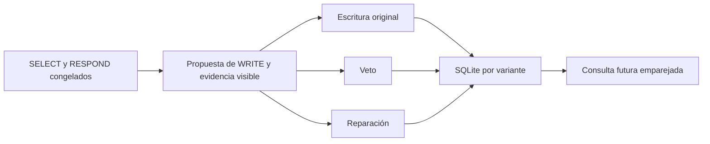

# Comparación de SFT y GRPO para aclarar preferencias

La campaña estudia cómo cambia la decisión de preguntar cuando se continúa el mismo selector mediante supervisión o recompensa longitudinal. Cada semilla usa su checkpoint LoRA limpio del brazo 0 % de la campaña de imperfecciones. El mismo checkpoint también funciona como referencia congelada. RESPOND y WRITE usan los pesos congelados de esa semilla y el lector futuro es simbólico. La comparación estima el efecto de entrenar SELECT bajo esas condiciones.

| Brazo | Aprendizaje del selector |
| --- | --- |
| SFT | Referencia de partida, paso cero |
| SFT adicional | Minimiza la pérdida categórica de las acciones del profesor observable |
| GRPO | Muestrea cuatro acciones legales y compara los retornos de sus trayectorias en el entorno |

Las dos continuaciones comparten orden de episodios TRAIN, LoRA entrenable, catálogo de acciones, tasa de aprendizaje, límite temporal y puntos de validación a mitad y al final del presupuesto. GRPO usa el entorno para obtener la aclaración, contestar, escribir y reabrir SQLite. Su presupuesto incluye esa recolección. Los brazos registran el tiempo efectivo, los grupos y cualquier exceso al terminar un grupo ya iniciado. La validación y el guardado tienen tiempos separados. Para reducir la repetición se reutiliza una salida congelada únicamente con el mismo prompt, límite de salida y semilla dentro de la misma partición. Cada trayectoria conserva su propia ejecución SQLite.

El checkpoint se elige solo en VALIDATION. El éxito conjunto estricto exige acierto actual y futuro sustentados, salida válida y operaciones de escritura respaldadas. Son elegibles los candidatos que mantienen o reducen las tasas de escritura sin respaldo y salida inválida del paso cero. Los desempates priorizan el acierto futuro, una menor tasa de preguntas sin información útil y el paso más temprano. La inferencia reservada empieza después de guardar y verificar la selección de todos los métodos y semillas. Los intervalos emparejan historias raíz dentro de familia y se condicionan a las semillas entrenadas.

## Ejecución

Desde la raíz, usa el Python del entorno de investigación con PyTorch, Transformers y PEFT. La corrida local usa Python 3.12 y PyTorch 2.7.1 con CUDA. Las rutas del banco y de pesos se resuelven localmente. Cada salida debe ser nueva.

```bash
CUBLAS_WORKSPACE_CONFIG=:4096:8 python -m research.tesis_comparison \
  --bank research/data/tesis_bank_v1 \
  --output research/runs/comparacion_tesis_nueva \
  --budget-seconds 300 --device cuda
```

Por defecto se usan 101, 202 y 303. `--plan-only` verifica el banco y todas las ramas del contexto sin cargar los pesos. `--validation-only` ejecuta entrenamiento y selección, y conserva cerrado el conjunto reservado. Para una comprobación rápida usa el banco `research/data/tesis_bank_smoke_v1`, con cinco raíces por partición, y `--budget-seconds 20`. Una comprobación breve certifica que el circuito se ejecutó y permite observar los resultados de esa muestra.

## Artefactos

- `PLAN.json` congela banco, fuentes, semillas, padres, presupuesto y criterio de selección. `TOKEN_PREFLIGHT.json` registra la longitud de las cinco ramas.
- `training/<semilla>/<método>/TRAINING.json` registra actualizaciones, cambios del adaptador, invariantes de pesos congelados, tiempos y métricas de validación.
- `SELECTION.json` identifica todos los pesos seleccionados y su banco reservado.
- `RESULTS.json` enlaza las trayectorias nativas y reporta medias, resultados por historia y familia e intervalos para diferencias emparejadas. Si dos brazos conservan los mismos pesos dentro de una semilla, comparten el archivo de trayectorias.

El protocolo implementado se etiqueta como exploratorio. La revisión humana del banco se registra aparte mediante el flujo de revisión del banco.

Para recalcular las métricas y auditar los prefijos, presupuestos, retornos de GRPO, pesos y selección desde los archivos conservados usa el verificador sin GPU:

```bash
python -m research.tesis_comparison_audit --run research/runs/comparacion_tesis_nueva
```

Para obtener diagnósticos por familia y fase con las mismas trayectorias emparejadas:

```bash
python -m research.tesis_metrics \
  --comparison-results research/runs/comparacion_tesis_nueva/RESULTS.json \
  --reference SFT --output reports/comparacion_tesis_metricas.json
```

## Comprobación ejecutada

La corrida de CUDA usó 20 segundos de presupuesto por continuación y semilla. El conjunto reservado contiene cinco historias y siete episodios por semilla. Las 21 celdas emparejadas corresponden a esas mismas cinco historias.

| Política seleccionada | Acierto actual sustentado | Acierto futuro sustentado | Éxito conjunto estricto | Pregunta sin información útil | Escritura sin respaldo |
| --- | ---: | ---: | ---: | ---: | ---: |
| SFT de partida | 66,7 % | 53,3 % | 0 % | 26,7 % | 70,0 % |
| SFT adicional | 60,0 % | 43,3 % | 0 % | 66,7 % | 83,3 % |
| GRPO | 66,7 % | 53,3 % | 0 % | 20,0 % | 70,0 % |

GRPO completó un grupo y dos pasos de optimizador por semilla. En los tres grupos, las ramas tuvieron idéntico retorno de tarea y la diferencia de recompensa vino del coste de preguntar. Solo la semilla 101 seleccionó un checkpoint actualizado. Su tasa de preguntas sin información útil bajó del 60 % al 40 % y su acierto futuro permaneció en 40 %. SFT adicional completó 38 pasos de optimizador en total. Esta ejecución mide el funcionamiento y los resultados de un presupuesto breve, con una sola historia por familia. [Resultados](../research/runs/tesis_comparison_smoke_v1/RESULTS.json) · [Auditoría](../reports/tesis_comparacion_smoke_v1/AUDITORIA.json) · [Diagnósticos](../reports/tesis_comparacion_smoke_v1/METRICAS.json)

En el banco completo se verificaron las ramas de 80 episodios TRAIN, 53 VALIDATION y 67 EVALUATION, con máximos de 1.311, 1.318 y 1.319 tokens respectivamente, frente al límite de 2.048. [Plan de la corrida completa](../research/runs/tesis_comparison_full_v1/PLAN.json) · [Longitudes](../research/runs/tesis_comparison_full_v1/TOKEN_PREFLIGHT.json)

## Resultado en 50 historias reservadas

Las tres semillas completaron la evaluación. Validación eligió el SFT inicial para GRPO en las tres semillas y un checkpoint entrenado de SFT adicional en la semilla 202. Se ejecutaron cuatro paneles distintos de 67 episodios. Los nueve pares de método y semilla reutilizaron el panel correspondiente cuando coincidían los pesos seleccionados.

| Selector elegido | Acierto actual | Acierto futuro | Éxito conjunto estricto | Preguntas informativas | Preguntas sin información útil | Escrituras sin respaldo |
| --- | ---: | ---: | ---: | ---: | ---: | ---: |
| SFT | 68,33 % | 49,67 % | 3,00 % | 15,33 % | 16,00 % | 66,33 % |
| SFT adicional | 68,33 % | 49,67 % | 3,00 % | 16,00 % | 16,00 % | 66,33 % |
| GRPO | 68,33 % | 49,67 % | 3,00 % | 15,33 % | 16,00 % | 66,33 % |

Los porcentajes promedian las familias y las semillas. Las tasas de preguntas y escrituras se expresan por episodio. Cada continuación tuvo asignados 300 segundos por semilla. SFT adicional ejecutó 560 pasos de optimizador. GRPO ejecutó 120 pasos en 60 grupos. En 16 de esos grupos, el retorno de tarea varió entre las ramas muestreadas. El mayor sobrepaso del presupuesto al completar un grupo fue de 8,45 segundos.

Las diferencias emparejadas de éxito estricto y acierto futuro fueron cero en las 50 historias. Los intervalos del 95 % se redujeron a [0, 0] en estas trayectorias y con estas semillas. En GRPO interviene la selección del mismo SFT inicial. La campaña compara los checkpoints elegidos por el criterio de validación. [Selección](../research/runs/tesis_comparison_full_v1/SELECTION.json) · [Resultados](../research/runs/tesis_comparison_full_v1/RESULTS.json) · [Auditoría](../reports/tesis_comparacion_completa_v1/AUDITORIA.json) · [Métricas por familia y semilla](../reports/tesis_comparacion_completa_v1/METRICAS.json)

## Verificación de escrituras sobre historias reservadas

Después de cerrar la comparación, usa sus trayectorias para medir el efecto de verificar WRITE. En cada episodio se mantienen fijos la decisión de preguntar, la réplica simulada, la respuesta actual y el lector. Se ejecutan la escritura original, el veto de operaciones sin respaldo y la reparación a partir de la evidencia visible. Cada variante abre su propia base SQLite para la consulta futura.



```bash
python -m research.tesis_memory_replay \
  --comparison-results research/runs/comparacion_tesis_nueva/RESULTS.json \
  --output reports/verificacion_tesis_nueva
```

El informe muestra el acierto futuro y las excepciones guardadas sin vencimiento. Cuenta por separado las propuestas originales que se rechazaron y las escrituras que se llegaron a aplicar en el original y cuyo efecto se perdió con el verificador. Una escritura omitida se mide entre los cambios permanentes que autoriza la evidencia disponible. Consulta los resultados por familia, método y semilla para localizar regresiones que se diluyen en la media.

La comparación usa 50 historias reservadas y 67 episodios por semilla en el banco completo. Los 201 episodios por método tras combinar las tres semillas corresponden a esas mismas 50 historias. La evaluación del verificador describe el banco sintético y su gramática de evidencia. Los intervalos de la comparación entre métodos se condicionan a las tres semillas entrenadas.

En la corrida completa, el veto elevó el acierto futuro de SFT y GRPO del 49,7 % al 60,7 %, y la reparación al 93,3 %. Con SFT adicional, el veto obtuvo 61,0 % y la reparación 94,0 %. En las tres políticas, el éxito conjunto estricto pasó de 3,0 % a 44,3 % con veto y a 67,0 % con reparación. El acierto actual se mantuvo en 68,3 %.

Por selector, las dos variantes evitaron las 138 escrituras ejecutadas sin respaldo y conservaron la única escritura respaldada del original. Los porcentajes se calculan como medias por familia. Los conteos conservan el denominador original y los desgloses por semilla. Los resultados sobre conservar escrituras respaldadas corresponden a una oportunidad por selector, con trayectorias compartidas cuando se seleccionan los mismos pesos. [Informe completo del verificador](../reports/tesis_verificador_reservado_full_v1/INFORME.md)

La prueba corta reprodujo 21 pares de semilla y episodio por método. El acierto futuro con reparación pasó del 53,3 % al 93,3 % en SFT y GRPO, y del 43,3 % al 100 % en SFT adicional. En esta muestra ningún brazo ejecutó escrituras respaldadas en su versión original. Las pruebas del verificador incluyen una escritura válida que debe conservarse y un lote fallido en el que esa escritura puede recuperarse. [Informe de la prueba corta](../reports/tesis_verificador_reservado_smoke_final/INFORME.md) · [Pruebas del verificador](../research/tests/test_tesis_memory_replay.py)
