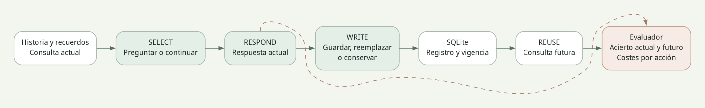
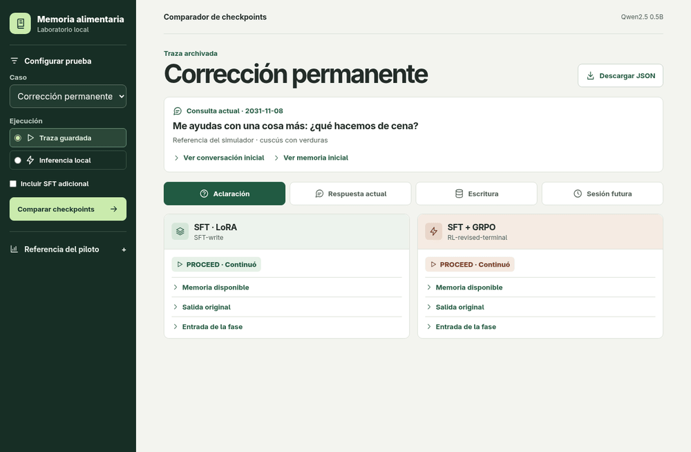
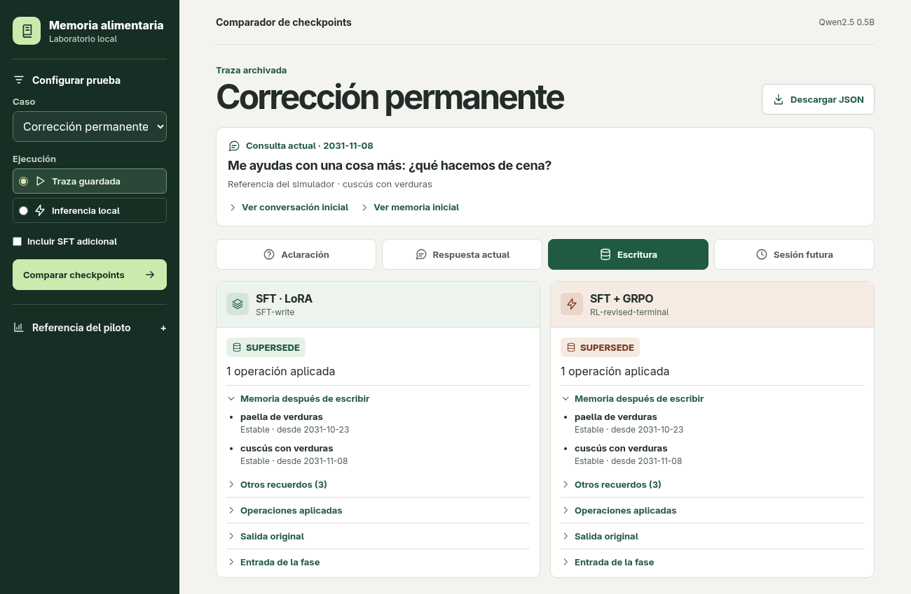
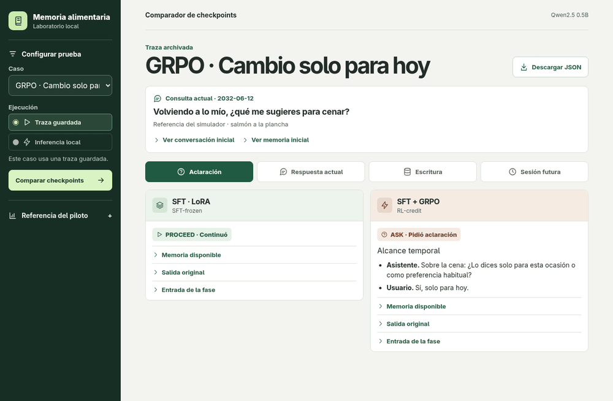
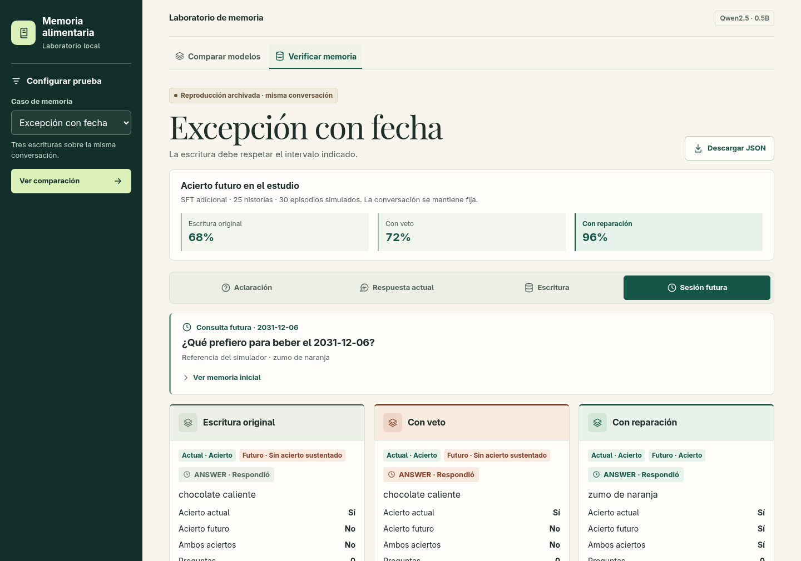

# Laboratorio local de memoria alimentaria

Conecta VS Code por Remote SSH a `servidor-tesis`, abre `~/tesis_clarificacion_longitudinal` y reenvía **8767** desde **Puertos**. En el chat de alimentación elige SFT o RL (GRPO), escribe «Mi cena habitual es locro de papa» y revisa **Memoria de esta conversación**. Abre la siguiente visita y pregunta «¿Qué cena tengo guardada?». En la simulación guiada puedes comparar cuándo se escribe un recuerdo y cuándo se recupera. [Chat de alimentación](http://127.0.0.1:8767/chat) · [Simulación guiada](http://127.0.0.1:8767/)

Si ya usas el puerto **8766**, tu marcador anterior abre el chat actual. Las conversaciones de v5 se consultan en el archivo. [Marcador anterior](http://127.0.0.1:8766/#perfiles) · [Archivo de conversaciones v5](http://127.0.0.1:8766/archivo#perfiles)

### Qué preguntar en el chat final

| Qué quieres probar | Qué puedes escribir | Qué mirar |
| --- | --- | --- |
| Explorar el menú | «¿Qué puedo cenar hoy sin pescado?», «¿Cómo lo preparo?», «Dame otra opción». También puedes pedir un desayuno o una bebida. | **Cómo respondió** identifica el catálogo o el recetario. Puedes ver la preparación de 13 platos y bebidas. Pedir ideas conserva la memoria sin añadir hábitos. |
| Recordar entre visitas | «Mi cena habitual es locro de papa». Abre la visita de mañana y pregunta «¿Qué tengo de cena habitual?». | En **Memoria de esta conversación**, abre **Ver frase de origen**. En la respuesta, despliega **Cómo respondió** para examinar la evidencia. |
| Comparar la decisión de aclarar | En conversaciones nuevas, prueba **Plan de cenas** y **Plan de desayunos** con ambos modelos. Deja la memoria vacía y usa el mismo primer mensaje al cambiar de modelo. | Abre **Cómo respondió** bajo la contestación y mira si la pregunta sigue disponible. Cada conversación dispone de una pregunta de aclaración compartida. |

SFT y RL usan los dos adaptadores v6 de Qwen2.5-1.5B seleccionados en validación. Ambos llegaron a la ronda 2. En el chat, Qwen puntúa preguntar o esperar ante una preferencia ambigua en las primeras dos visitas. El lector y el escritor trabajan sobre SQLite. Las ideas de comidas y sus preparaciones proceden de un catálogo compartido. Cada conversación tiene su propia base dentro de `outputs/final_food_chats` en la USFQ. Para retomarla, abre el mismo navegador y puerto. El selector **Conversación** te permite volver a la prueba que guardaste con ese modelo.

## Perfiles y memoria v5

La vista archivada **Perfiles y memoria** usa Qwen2.5-1.5B con los adaptadores de la corrida v5. Los recorridos históricos de las otras vistas comparan Qwen2.5-0.5B-Instruct con adaptadores LoRA. Reenvía **8766**. Si VS Code asigna un puerto local distinto, abre la dirección que muestra y añade `/archivo#perfiles`. [Perfiles y memoria en el archivo v5](http://127.0.0.1:8766/archivo#perfiles)

**Nombre de tu prueba** permite mantener conversaciones separadas en este navegador. **Quién decide cuándo preguntar** identifica cada opción por método, semilla y época. La opción seleccionada en validación y la última época aparecen identificadas en el menú. La nota bajo el selector indica su elegibilidad. Puedes cambiar de modelo para retomar su conversación propia y comparar decisiones con los mismos mensajes.

La conversación, las visitas anteriores y los recuerdos se guardan en SQLite dentro de `outputs/profiles_v5_chats` en el servidor. El navegador conserva el identificador y el token que permiten recuperarlos al recargar o volver a abrir la página. Cerrar VS Code, desconectar SSH o apagar el PC deja esos datos en el servidor. Al volver, reenvía el puerto y abre el laboratorio con el mismo navegador. Borrar su almacenamiento local elimina el acceso guardado a esas conversaciones. Tras guardar la primera prueba, **Conversaciones guardadas en este navegador** permite volver a sus recuerdos por nombre, método y semilla. Los nombres proceden exclusivamente de los accesos guardados en ese navegador.

El servidor mantiene la interfaz en la sesión desacoplada `laboratorio-perfiles-v5` del socket tmux `tesis-clarificacion`. Después de un reinicio del **servidor** puedes volver a abrir el proceso desde la terminal remota con este comando. Reutiliza las conversaciones guardadas.

```bash
cd ~/tesis_clarificacion_longitudinal
tmux -L tesis-clarificacion has-session -t laboratorio-perfiles-v5 2>/dev/null ||
  tmux -L tesis-clarificacion new-session -d -s laboratorio-perfiles-v5 \
    'CUDA_VISIBLE_DEVICES=0 HF_HUB_OFFLINE=1 ~/.local/share/tesis-clarificacion/a100/bin/python -u -m web_demo --device cuda --port 8766 --final-lab-port 8767 >> logs/laboratorio_perfiles_v5.log 2>&1'
```

### Comprobar una excepción y su vencimiento

1. Selecciona un modelo disponible y una prueba nueva. Envía «Mi cena habitual es locro de papa».
2. Envía «Solo por hoy prefiero sopa de zapallo para la cena». Revisa en **Recuerdos y evidencia** la preferencia habitual y la excepción del día, con sus citas.
3. Abre **Cambiar de visita o fecha**, conserva la fecha y pulsa **Saltar a la siguiente visita**. Envía «¿Qué cena tengo guardada?». La excepción de ese día todavía aplica.
4. Cambia la fecha al día siguiente y abre otra visita. Repite «¿Qué cena tengo guardada?». El hábito anterior vuelve a ser aplicable y la excepción figura vencida.

También puedes enviar de una vez «Suelo cenar locro de papa. Solo por hoy prefiero sopa de zapallo». Estas redacciones se verifican en las pruebas del chat. Si el modelo pregunta por un dato, contesta con tus palabras y comprueba qué cita se guardó. El tratamiento de «solo por hoy» conserva un intervalo de calendario. Una preferencia explícita «solo para esta sesión» termina al abrir otra visita aunque la fecha se mantenga. [Pruebas semánticas del chat](../tests/test_profiles_chat_semantics_qa.py) · [Persistencia y vigencia](../tests/test_profiles_chat.py)

El recorrido en Chromium sobre la A100 probó tres visitas con una cena habitual y una excepción con fecha de fin. El día final se recuperó sopa y al día siguiente se recuperó pasta. Al reabrir la página y reiniciar el proceso del servidor se conservaron el historial, las citas y el presupuesto. [Captura de la tercera visita](../reports/tesis_profiles_review_v5/INTERFAZ_A100.png) · [Registro del recorrido y de los tres modelos](../reports/tesis_profiles_review_v5/INTERFAZ_A100.json)

### Qué ejecuta y qué mide la demo

Qwen elige una acción del menú permitido usando los mensajes, el presupuesto restante y los recuerdos visibles. La inferencia usa los pesos del checkpoint identificado en el selector. El escritor y el lector comunes del entorno v5 construyen y comprueban las operaciones de memoria y las respuestas sustentadas. **Ver decisión y evidencia** muestra la acción, las escrituras, las citas y la procedencia del modelo. Las adaptaciones de redacción para el chat libre se conservan en la traza de ejecución. [Inferencia de checkpoints](../web_demo/profiles_runtime.py) · [Conversación persistente](../web_demo/profiles_chat.py) · [Redacciones admitidas](../web_demo/profiles_evidence.py)

Cada conversación tiene dos preguntas de aclaración compartidas entre sus visitas. Abrir una visita conserva ese presupuesto y los recuerdos, y archiva el intercambio anterior. La fecha y el lugar se eligen al abrir la siguiente visita. También puedes preguntar por «mañana», una fecha ISO o «en casa» para consultar una situación distinta de la actual. El entrenamiento y el banco de perfiles usan tres visitas. Continuar después amplía ese horizonte y se identifica como exploración en la interfaz.

La prueba libre admite preferencias de cena, desayuno y bebida. Su resultado depende de que el analizador reconozca la redacción y de que exista evidencia suficiente para guardar una vigencia o recuperar una preferencia. Cuando una expresión requiere aclaración, el modelo puede solicitarla dentro del presupuesto. Las consultas propias permiten inspeccionar el comportamiento y sus citas. La comparación científica procede del banco reservado sintético, de sus anotaciones revisadas por IA y de los checkpoints fijados antes de evaluarlo.

**Ver resultados de esta corrida** salta al informe dentro de la misma pantalla. Las tablas reservadas se presentan después de verificar la selección de checkpoints. Incluyen el contraste primario, su intervalo y el criterio fijado, además del diagnóstico de respuesta, escritura y recuperación del analizador. **Resultados de tesis** también ofrece acceso a esta comparación. [Informe de la corrida v5](../reports/tesis_profiles_qwen_a100_v5/INFORME.md) · [Protocolo de perfiles](experimento_perfiles_usuarios.md) · [Plan, selección y evaluación v5](../research/tesis_profiles_v5.py)



## Recorrido visual

El GIF recorre una corrección permanente con la traza de ambos checkpoints. Los dos escriben el nuevo valor y el lector lo recupera en otra sesión. Solo GRPO acierta también la respuesta actual sustentada, por lo que «Ambos aciertos» vale Sí en su tarjeta.



En Escritura se puede desplegar la memoria inicial y contrastarla con los registros de cada checkpoint. Las operaciones son las que el simulador ejecutó en el episodio.



El segundo GIF muestra «GRPO · Cambio solo para hoy». Los modelos oyen la misma historia. GRPO pregunta por la duración y obtiene «Sí, solo para hoy» del simulador. En la consulta futura, la preferencia habitual es la que sigue vigente. Este ejemplo corresponde al GRPO con crédito por fase y usa su traza archivada.



## Abrir el laboratorio

Desde la raíz del proyecto:

```bash
python -m web_demo --port 8765
```

Abre [el laboratorio en el navegador](http://127.0.0.1:8765). El servidor escucha en la interfaz local. El modo de reproducción usa la biblioteca estándar de Python y las trazas de ocho casos emparejados. Seis casos admiten inferencia nueva.

**Conversar** ejecuta el Qwen2.5 local con el adaptador que elijas. Cada modelo tiene su propia memoria SQLite. Puedes empezar con «Para la cena, prefiero sopa de verduras de forma habitual». Si el modelo aclara algo, responde en el mismo cuadro. Abre **Nueva sesión** y escribe «¿Qué prefiero para cenar?» para probar si recupera el recuerdo con el historial de chat vacío. La memoria dura mientras el servidor esté abierto y la página puede retomar el chat al recargarse en la misma pestaña.

**Abrir historial simulado** carga dos sesiones anteriores, sus mensajes y tres recuerdos ficticios en una conversación propia para cada perfil. Puedes probar «¿Qué prefiero para cenar hoy?», abrir **Nueva sesión** y repetir la pregunta. «¿Qué prefiero para cenar mañana?» consulta la preferencia habitual. **Volver a mi chat** recupera tu conversación previa. **Sesiones anteriores** también guarda los mensajes que escribiste en sesiones cerradas.

La salida original está en **Ver decisiones del modelo**. Con **Verificar recuerdos y sugerencias** activado, el lector contrasta la consulta explícita con los recuerdos de SQLite y la escritura se comprueba con las evidencias del usuario. El botón de la cabecera cambia entre modo claro y oscuro.

Al pedir una comida, **Conversar** entrega a Qwen el catálogo con ingredientes y la preferencia vigente si SQLite recupera un valor único. Con el verificador activo, el chat puede priorizar el plato recordado compatible, sustituir una sugerencia incompatible o pedir más datos si se agota el menú. Las exclusiones y rectificaciones se aplican a la comida, la persona y la fecha del pedido. «Solo por hoy» se conserva hasta el siguiente día local, «solo en esta conversación» acaba al cambiar de sesión y «desde ahora» actualiza la preferencia habitual. Los [casos de regresión](../tests/fixtures/chat_recommendations.json) se ejecutan con `python -m pytest tests/test_web_chat.py`.

Puedes pedir comida sin formular una pregunta, por ejemplo «Ayer comí pollo, no quiero repetirlo, quiero algo para comer hoy». Si luego dices «para esta ocasión», el chat sigue usando las exclusiones de esa comida. Una afirmación como «Prefiero pasta» sigue el flujo de aclaración de memoria.

**Conversar** ofrece dos perfiles, **SFT** y **RL (GRPO)**. Los dos reciben el menú completo con ingredientes y eligen un plato o una aclaración. Desmarca **Verificar recuerdos y sugerencias** para observar la elección original. Abre **Ver decisiones del modelo** para consultar la letra, su plato y el orden del menú. En las consultas de memoria, ambos perfiles usan el controlador SFT compartido para decidir, responder y proponer escrituras en SQLite. [Método y reproducción](justificacion_grpo_tesis.md#recomendaciones-con-exclusiones-en-qwen).

Prueba «¿Qué ceno hoy sin aceite ni papas?» y luego «Ya conseguí papas, el aceite sigue fuera. ¿Qué ceno?». Mantén ambos mensajes en la misma sesión. **Conversar** usa SFT y GRPO con muestreo de la semilla 202, la primera semilla en la que la validación eligió pesos actualizados para ese GRPO. En **Resultados de tesis → Exploración de las seis acciones del menú** puedes consultar las aclaraciones correctas, los platos incompatibles y las épocas elegidas de cada método para las tres semillas. [Prueba en varias semillas](justificacion_grpo_tesis.md#grpo-con-exploración-de-las-seis-acciones).

**Comparar modelos** permite recorrer la aclaración, la respuesta, la escritura y la sesión futura de los checkpoints. **Resultados de tesis** muestra la comparación y el efecto del verificador en las 50 historias reservadas. En **Verificar memoria** puedes recorrer ejemplos de ese banco y de los pilotos previos. La vista empieza por la sesión futura y compara escritura original, veto y reparación con la misma interacción. Abre la fase **Escritura** para ver las operaciones y la evidencia.

En **Resultados de tesis**, la comparación de varios turnos incluye los checkpoints terminales y los seleccionados en validación. Elige una historia reservada y pulsa **Tomar las decisiones en este caso**. Puedes pedir una aclaración, leer la réplica del usuario simulado y continuar hasta la segunda conversación. La sección de memoria muestra el estado de SQLite y las consultas posteriores revelan qué preferencia sigue vigente. [Protocolo y resultados](justificacion_grpo_tesis.md#contraste-con-varias-decisiones-por-historia).



Para hacer **inferencia nueva**, ejecuta el mismo módulo con el Python que tiene PyTorch, Transformers y PEFT instalados. En esta máquina se verificó el entorno histórico de Python 3.12:

```bash
.venv-llm-local/bin/python \
  -m web_demo --port 8765 --device cpu
```

Si esa ruta no existe en otra máquina, crea un entorno con `uv venv --python 3.12 .venv-lab` e instala las dependencias con `uv pip install --python .venv-lab/bin/python -r research/requirements.txt`. Luego ejecuta `.venv-lab/bin/python -m web_demo --port 8765 --device cpu`. Los pesos del modelo y los adaptadores se leen del disco. La primera comparación en CPU tomó alrededor de dos minutos en esta máquina. CPU calcula en FP32 sobre los valores base redondeados a BF16. Si Torch tiene CUDA operativa, puedes usar `--device cuda`. Las salidas nuevas pueden variar frente a las trazas archivadas debido al dispositivo y la precisión.

## Presupuesto compartido con Qwen 1.5B

En **Presupuesto**, elige una historia y una política. Recorre las dos visitas paso a paso, decide tú qué hacer o ejecuta la política seleccionada. El panel muestra cuántas preguntas quedan y qué recuerdos respaldan las consultas futuras cuando acaba la historia. Para comparar, mantén fija la historia y repítela con la regla, el planificador, Qwen inicial, SFT y GRPO. Las historias provienen del banco de desarrollo.

En el servidor abre una terminal de VS Code conectada a `servidor-tesis`. Inicia el laboratorio en la interfaz local del servidor y reenvía el puerto **8765** desde la pestaña **Puertos** de VS Code.

```bash
cd ~/tesis_clarificacion_longitudinal
OMP_NUM_THREADS=4 HF_HUB_OFFLINE=1 "$HOME/.local/share/tesis-clarificacion/a100/bin/python" \
  -m web_demo --port 8765 --device cpu \
  --budget-run reports/tesis_shared_budget_qwen_matched_a100_v2
```

También puedes abrir el túnel desde una terminal de tu PC con `ssh -N -L 8765:127.0.0.1:8765 servidor-tesis`. Con el reenvío activo, abre el laboratorio en el navegador. El manifiesto de la corrida vincula cada política a su adaptador seleccionado. El dispositivo `cpu` permite usar el laboratorio mientras la A100 está ocupada. Usa `--device cuda` cuando tengas una GPU libre. [Laboratorio reenviado](http://127.0.0.1:8765/#presupuesto) · [Protocolo y mejoras pendientes](justificacion_presupuesto_compartido.md#comparación-de-qwen-15b)

Para ver por qué vale la pena reservar la aclaración, elige **Poco tiempo y otra decisión incierta**. Selecciona Qwen con SFT o GRPO y pulsa **Ejecutar un paso**. En la segunda visita, el indicador de preguntas restantes permite comprobar si la primera decisión dejó presupuesto para aclarar. Usa **Comparar desde el inicio** para ejecutar las políticas sobre la misma historia. La variante anterior queda accesible pasando el directorio `reports/tesis_shared_budget_qwen_matched_a100_v1` a `--budget-run`. [Diagnóstico de la primera variante](../reports/tesis_shared_budget_qwen_matched_a100_v1/INFORME.md)

## De dónde salen las decisiones

Cada checkpoint procesa el mismo episodio inicial con su propia base SQLite. El actor observa la consulta, los turnos visibles y los recuerdos disponibles. Si pregunta, el simulador devuelve la aclaración que corresponde al mundo del caso. WRITE recibe su propia observación. REUSE abre la base de nuevo y recibe únicamente memoria y consulta. El evaluador compara las salidas con la verdad del simulador y registra aciertos, citas y costes.

- [Entorno y simulador](../research/src/env/) aplican las reglas del episodio y responden a las aclaraciones.
- [Memoria](../research/src/memory/) valida y ejecuta las operaciones, con fechas, contexto y referencias a turnos.
- [Controlador Qwen](../research/src/policy/llm_controller.py) ejecuta SELECT, RESPOND y WRITE con el adaptador elegido.
- [Lector de la sesión futura](../research/src/readers/symbolic.py) filtra por fecha, sesión y contexto.
- [Entrenamiento](../research/src/training/) y [evaluador](../research/competence_evaluation.py) guardan checkpoints, trazas y resultados.
- [Servidor del laboratorio](../web_demo/__main__.py) expone los casos guiados y la interfaz local.

## Qué mirar en cada fase

| Fase | Qué puedes comprobar |
| --- | --- |
| Aclaración · SELECT | `ASK` solicita información; `PROCEED` continúa. Cuando hay una pregunta, el simulador contesta desde el mundo del caso. |
| Respuesta actual · RESPOND | La salida estructurada contiene una respuesta, condiciones o aplazamiento. Las citas se contrastan con el diálogo y la memoria visibles. |
| Escritura · WRITE | El modelo propone operaciones y el entorno registra cuáles se aplicaron. La memoria muestra valor, alcance, fechas y contexto. En la sesión futura aparecen «Vencido» para los intervalos que terminaron y «Citado» para los registros que usó el lector. El fin del intervalo es exclusivo. |
| Sesión futura · REUSE | El lector común recibe la memoria reabierta desde SQLite y la nueva consulta. Se ven el resultado, los aciertos y el retorno del episodio. |

- **Corrección permanente.** Cambia a Escritura y compara los registros con la memoria inicial. En Sesión futura, verifica si el nuevo valor se sigue usando.
- **Excepción temporal y cambio por contexto.** Compara la fecha o el lugar de consulta con el intervalo guardado. Revisa qué preferencia recupera el lector al cambiar de sesión.
- **Duración ambigua.** Alterna entre los dos desenlaces. El prefijo es el mismo y la respuesta simulada a la aclaración cambia.
- **GRPO · Cambio solo para hoy / Cambio desde ahora.** Estas trazas del ensayo dirigido muestran la pregunta de GRPO ante el mismo diálogo inicial y dos réplicas posibles del simulador.
- **Consulta propia.** Selecciona «Inferencia local» y escribe en «Editar pregunta». La simulación conserva el atributo, las fechas y el resto de la historia. La interfaz desactiva la puntuación de ese ejemplo.
- **Escrituras verificadas.** En «Inferencia local», activa «Verificar escrituras» para comprobar la propuesta antes de persistirla. En «Escritura» puedes examinar la propuesta y qué operaciones se aceptaron, bloquearon o recuperaron.
- **Inspección.** Abre «Entrada de la fase» o «Salida original», y usa «Descargar JSON» para conservar acciones, memoria, procedencia y métricas disponibles.

## Qué significa que GRPO tenga peso

SFT aprende de demostraciones. GRPO parte de un adaptador SFT y actualiza LoRA comparando varias trayectorias del mismo estado, con ventajas calculadas dentro del grupo y una referencia SFT congelada. En el horizonte longitudinal, la recompensa incorpora las consecuencias de acertar hoy y conservar un recuerdo útil para más adelante. Un grupo con el mismo retorno para todas las ramas aporta una ventaja de tarea cero. [Código y contrato de entrenamiento](../research/TRAINING.md) · [Artículo original de GRPO](https://arxiv.org/abs/2402.03300).

Los resultados disponibles tienen una sola semilla por piloto y pertenecen a conversaciones sintéticas. Se mide el **éxito conjunto J** cuando tanto la respuesta actual sustentada como la consulta futura son correctas. Las familias pesan lo mismo. Una curva de pérdida, un cambio de pesos o una subida de retorno por reducir el coste de preguntar miden fenómenos distintos de J.

| Ensayo de 25 historias | SFT de partida | GRPO | Referencia adicional |
| --- | ---: | ---: | ---: |
| SFT débil y continuación longitudinal | 34 % | 34 % seleccionado en paso 0; 30 % terminal | 64 % más SFT desde el mismo padre con tiempo comparable |
| SFT de escritura y GRPO con recompensa revisada, usado en la demo | 52 % | 52 % seleccionado en paso 0; 60 % terminal | 68 % SFT adicional desde el padre anterior al ajuste de escritura |

En la segunda fila, GRPO revisado ejecutó 12 actualizaciones, con 48 trayectorias y señal de tarea en 10 de 12 grupos. El terminal mejoró dos raíces y empató las otras 23 frente a su padre, pero empató con el inicio en validación. Ambos checkpoints hicieron cero preguntas. El otro brazo GRPO de esa corrida, con recompensa conjunta, sí eligió el paso 12, que obtuvo 56 % de J. [Comparación por brazo](../research/runs/reward_review_20261104_002/COMPARISON.json) · [Selección por validación](../research/runs/reward_review_20261104_002/SELECTION.json) · [Primer piloto SFT–GRPO](../reports/weak_sft_natural_20261104_001/INFORME_COMPARACION.md).

En cambio, la variante dirigida con crédito por fase sí seleccionó un checkpoint entrenado y, frente a su mismo padre SFT congelado, elevó el éxito conjunto estricto de **22 % a 34 %** y el acierto futuro de **36 % a 48 %** en 25 historias. Las preguntas innecesarias subieron de **40 % a 48 %**. Esa corrida tiene una semilla y compara con el padre congelado. [Informe del GRPO dirigido](../reports/reward_review_targeted_20261105_002/INFORME.md) · [Auditoría reproducible de ambos pilotos](evaluacion_sft_grpo.md).

La línea posterior entrenó un controlador pequeño sobre Qwen congelado. En 50 consultas su 16 % de acierto igualó a Qwen congelado, mientras que las reglas públicas llegaron a 88 %. La diferencia de retorno de +0,10 frente a Qwen vino del coste de una pregunta eliminada. Este resultado corresponde a otro controlador y banco. [Informe del controlador](../reports/reward_review_decision_20261105_003/INFORME.md).

La comparación de tesis usa el mismo punto de partida y presupuesto por semilla. La validación eligió el SFT inicial para GRPO en las tres semillas antes de evaluar las 50 historias reservadas. Las cifras de las tarjetas del laboratorio corresponden a los pilotos de los que procede cada traza. [Resultados del banco completo](comparacion_tesis.md#resultado-en-50-historias-reservadas) · [Protocolo experimental](../research/README.md).

El piloto nuevo aísla la decisión de preguntar y mantiene fijos los pesos usados para responder y escribir. En GPU ejecutó 16 actualizaciones LoRA y encontró señal de tarea en seis de ocho grupos. Validación conservó el checkpoint SFT inicial. En las diez historias reservadas, el éxito estricto fue 40 % para ese checkpoint y 35 % para el terminal. El terminal preguntó en el 100 % de los episodios, frente al 50 % de SFT. [Diseño y reproducción del piloto](grpo_selector.md) · [Resultado verificable](../research/runs/grpo_select_20261114_002/RESULT.json).

## Pruebas reproducibles

La suite completa se ejecutó con el entorno de investigación y completó 1.149 pruebas, con una omitida. También se comprobó desde el navegador la inferencia real en CPU con una consulta editada, la navegación por teclado y el funcionamiento a partir de 320 px de ancho.

```bash
# Usa el Python del entorno de investigación, con pytest instalado.
CUBLAS_WORKSPACE_CONFIG=:4096:8 PYTHONDONTWRITEBYTECODE=1 PYTHONPATH=.:tests \
  python -m pytest -p no:cacheprovider -q tests research/tests

# Esta auditoría también funciona con un Python sin dependencias pesadas.
python -m research.weak_sft_qa --archived research/runs/weak_sft_natural_20261104_001
```

La auditoría archivada vuelve a puntuar las trayectorias del piloto SFT débil y verifica las comparaciones pareadas y la señal de los grupos GRPO. Puedes añadir una ruta nueva después del nombre de la corrida para guardar el resultado en JSON.

Con el servidor abierto, este comando devuelve la traza con la aclaración de GRPO y el estado de SQLite para cada modelo. Sirve para probar el laboratorio desde una terminal o leer el JSON con otra herramienta.

```bash
curl -fsS http://127.0.0.1:8765/api/compare \
  -H 'Content-Type: application/json' \
  -d '{"scenario_id":"grpo-ambigua","mode":"replay"}'
```

Si `nvidia-smi` devuelve `Driver/library version mismatch`, comprueba CUDA directamente con el Python de entrenamiento:

```bash
python -c 'import torch; x = torch.ones(4, device="cuda"); print(torch.cuda.get_device_name(0), x.sum().item())'
```

En este equipo había un desajuste visible entre el módulo NVIDIA 615.78.08 y NVML 620.70.06, pero una operación CUDA de PyTorch sí se ejecutó. La opción CPU permite comprobar los pesos mientras se diagnostica el controlador. [Guía de NVIDIA sobre el módulo cargado](https://docs.nvidia.com/datacenter/tesla/driver-installation-guide/post-installation-actions.html).
